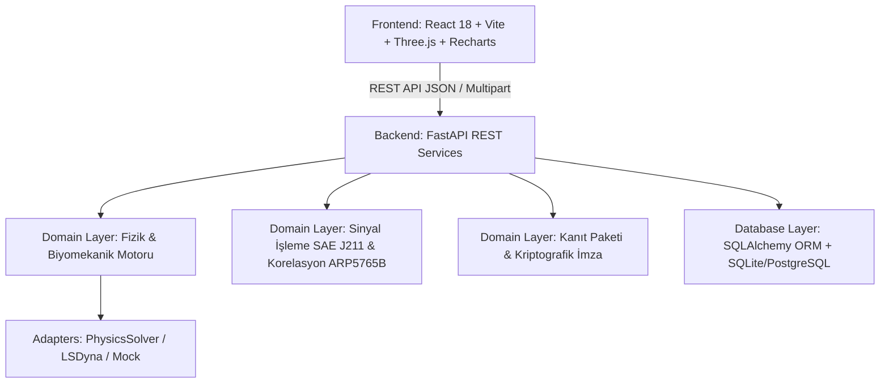

# ✈️ AeroSeat V2.0 — Mimari Haritası ve Kod Tabanı Kılavuzu

Bu belge, **AeroSeat** projesinin mimari yapısını, dosya hiyerarşisini ve havacılık sertifikasyon standartlarına (14 CFR § 25.562 / SAE AS8049E / SAE ARP5765B) göre modellenmiş iş akışlarını açıklayan resmi kılavuzdur.

---

## 🏛️ 1. Genel Mimari Bakış (High-Level Architecture)

AeroSeat, uçak yolcu koltuklarının dinamik çarpışma (dynamic crashworthiness) sertifikasyonunu sanal ortamda simüle eden, biyomekanik yaralanma kriterlerini hesaplayan ve kanıt zincirini (evidence hash-chain) denetlenebilir kılan tam yığın (full-stack) bir CAE/M&S platformudur.



---

## 📂 2. Dosya Ağacı ve Kod Dağılımı

### 🖥️ A. Backend Katmanı (`backend/app/`)

| Klasör / Dosya | İçerik & Sorumluluk | İnceleyen Kişi Neden Buraya Bakmalı? |
| :--- | :--- | :--- |
| **`app/domain/physics/`** | | **Fizik ve Çarpışma Dinamikleri** |
| ├── [`lumped_mass_model.py`](file:///C:/Users/maozk/Desktop/AeroSeat/backend/app/domain/physics/lumped_mass_model.py) | 6-DOF dinamik lumped-mass çarpışma motoru. D'Alembert denklemleri, minderin (cushion) ve sırtlığın (backrest) viskoelastik temas kuvvetleri, 3 noktalı emniyet kemeri gerilimi, HIII ATD kütle matrisi. | Simülasyonun hareket denklemlerini ve darbe mekaniğini incelemek için. |
| ├── [`pulse_library.py`](file:///C:/Users/maozk/Desktop/AeroSeat/backend/app/domain/physics/pulse_library.py) | 16g Forward ve 14g Downward standart SAE darbeleri ile kullanıcı tarafından yüklenen custom CSV darbe eğrilerinin kübik/lineer interpolasyonu. | Çarpışma ivme profilinin ($a(t)$) nasıl oluşturulduğunu görmek için. |
| └── [`signal_processing.py`](file:///C:/Users/maozk/Desktop/AeroSeat/backend/app/domain/physics/signal_processing.py) | SAE J211-1 4. derece Butterworth sıfır-fazlı filtreleme (`filtfilt`), $\Delta v$ (hız değişimi) trapezoid integral doğrulaması. | Sinyal filtreleme ve hız değişimi limit kontrolünü incelemek için. |
| **`app/domain/`** | | **Biyomekanik Kriterler, QA ve Raporlama** |
| ├── [`injury_metrics.py`](file:///C:/Users/maozk/Desktop/AeroSeat/backend/app/domain/injury_metrics.py) | HIC15 sliding-window hesaplaması ($[t_1, t_2]$ zaman penceresi), Nij boyun indeksi, Femur basma yükleri, Lumbar omurga yükü, Emniyet kemeri şerit yükleri. | Biyomekanik yaralanma kriterlerinin formüllerini ve limit kontrolünü görmek için. |
| ├── [`model_qa.py`](file:///C:/Users/maozk/Desktop/AeroSeat/backend/app/domain/model_qa.py) | Model QA Pre-Flight Gate. CAD geometri bütünlüğü, darbe yönü, malzeme eşleşmesi ve FE kontrol raporu. | Simülasyon öncesi kalite kontrol (QA) denetimlerini görmek için. |
| └── [`evidence_generator.py`](file:///C:/Users/maozk/Desktop/AeroSeat/backend/app/domain/evidence_generator.py) | ReportLab tabanlı resmi FAA/EASA uyumlu Evidence PDF rapor üretimi, SHA-256 girdi/çıktı manifestleri. | Denetlenebilir PDF sertifikasyon raporunun nasıl üretildiğini görmek için. |
| **`app/domain/contracts/`** | | **Bilimsel İşleme ve Korelasyon Standartları** |
| ├── [`scientific_processing.py`](file:///C:/Users/maozk/Desktop/AeroSeat/backend/app/domain/contracts/scientific_processing.py) | 8 adımlı bilimsel sinyal işleme pipeline'ı (Birim normalizasyonu, CFC filtresi, Time-Zero tespiti, ortak zaman gridi). | Ham sensör verilerinin standart analize nasıl hazırlandığını görmek için. |
| ├── [`correlation.py`](file:///C:/Users/maozk/Desktop/AeroSeat/backend/app/domain/contracts/correlation.py) | SAE ARP5765B Sprague-Geers korelasyon metriği ($M$ magnitude, $P$ phase, $C$ comprehensive error, tepe hatası, RMS). | Simülasyon ile fiziksel test arasındaki eğri benzerlik algoritmasını incelemek için. |
| └── [`golden_dataset.py`](file:///C:/Users/maozk/Desktop/AeroSeat/backend/app/domain/contracts/golden_dataset.py) | 3 katmanlı regresyon dürüstlük kontrolü (Smoke test). | Kod değişikliklerinde bilimsel pipeline'ın bozulmadığını doğrulamak için. |
| **`app/adapters/solver/`** | | **Solver Adaptörleri ve Soyutlama Katmanı** |
| ├── [`factory.py`](file:///C:/Users/maozk/Desktop/AeroSeat/backend/app/adapters/solver/factory.py) | `PHYSICS_LUMPED_MASS`, `LSDYNA`, `MOCK` adaptör seçici. Yanıltıcı isim kullanımını engelleyen katı ayrım. | Solver seçim fabrikasını ve lisans denetim mantığını görmek için. |
| ├── [`physics_solver.py`](file:///C:/Users/maozk/Desktop/AeroSeat/backend/app/adapters/solver/physics_solver.py) | `PhysicsSolverAdapter` somut uygulaması. Simülasyonu çalıştırır ve zaman serilerini ayrıştırır. | Fizik motoru çalıştırma ve çıktı dosyalama mantığını görmek için. |
| ├── [`lsdyna.py`](file:///C:/Users/maozk/Desktop/AeroSeat/backend/app/adapters/solver/lsdyna.py) | Gerçek LS-DYNA anahtar kelime (.k) güvertesi oluşturucu, HPC iş referansı ve d3plot/binout parser. | LS-DYNA entegrasyon altyapısını görmek için. |
| └── [`base.py`](file:///C:/Users/maozk/Desktop/AeroSeat/backend/app/adapters/solver/base.py) | Solver soyut taban sınıfı (`BaseSolverAdapter`). | Yeni bir solver (Abaqus, Radioss vb.) eklemek için. |
| **`app/api/v1/endpoints/`** | | **REST API Uç Noktaları** |
| ├── [`projects.py`](file:///C:/Users/maozk/Desktop/AeroSeat/backend/app/api/v1/endpoints/projects.py) | Koltuk mimarileri (`SeatArchitecture`) ve CAD revizyonları CRUD API'leri. | Proje ve CAD revizyonu yönetimini incelemek için. |
| ├── [`cad_upload.py`](file:///C:/Users/maozk/Desktop/AeroSeat/backend/app/api/v1/endpoints/cad_upload.py) | Gerçek CAD (.step, .stp, .iges, .stl) dosya yükleme, SHA-256 hash alma ve parça manifesti oluşturma. | CAD dosya yükleme mantığını görmek için. |
| ├── [`pulse_upload.py`](file:///C:/Users/maozk/Desktop/AeroSeat/backend/app/api/v1/endpoints/pulse_upload.py) | Özel çarpışma darbesi CSV yükleme ve hız değişimi ($\Delta v$) doğrulama endpoint'i. | Darbe CSV yükleme ve regülasyon uygunluk kontrolünü görmek için. |
| ├── [`simulations.py`](file:///C:/Users/maozk/Desktop/AeroSeat/backend/app/api/v1/endpoints/simulations.py) | Simülasyon konfigürasyonu oluşturma, idempotency/execution fingerprint kontrolü ve simülasyon çalıştırma. | Simülasyon başlatma ve önbellekleme (caching) mantığı için. |
| ├── [`correlation.py`](file:///C:/Users/maozk/Desktop/AeroSeat/backend/app/api/v1/endpoints/correlation.py) | Fiziksel test yükleme/okuma, ARP5765B korelasyon çalıştırma ve mühendis onay (Credibility Assessment) API'si. | Korelasyon ve mühendis onaylama süreçlerini görmek için. |
| └── [`evidence.py`](file:///C:/Users/maozk/Desktop/AeroSeat/backend/app/api/v1/endpoints/evidence.py) | Mühendislik değerlendirmesi, Evidence paketi oluşturma ve imzalı PDF indirme endpoint'i. | Sertifikasyon kanıt zinciri ve PDF indirme akışı için. |
| **`app/db/`** | | **Veritabanı ve Veri Modelleri** |
| ├── [`models.py`](file:///C:/Users/maozk/Desktop/AeroSeat/backend/app/db/models.py) | Değiştirilemez (immutable) veri şeması: SeatArchitecture, ModelRevision, SimulationConfiguration, SolverJob, SimulationResult, InjuryMetrics, EvidenceArtifact. | Tüm veritabanı tablolarını ve ilişkilerini incelemek için. |
| ├── [`init_db.py`](file:///C:/Users/maozk/Desktop/AeroSeat/backend/app/db/init_db.py) | Veritabanı tablolarının oluşturulması, otomatik `ALTER TABLE` geçişleri ve seed verileri. | DB başlangıç durumunu ve migrasyonları görmek için. |
| └── [`triggers.py`](file:///C:/Users/maozk/Desktop/AeroSeat/backend/app/db/triggers.py) | Değiştirilemezlik (immutability) event listener'ları. Tamamlanmış revizyon veya kanıtların silinmesini/güncellenmesini engeller. | Regülasyonel veri güvenliğini incelemek için. |
| **`tests/`** | | **21 Adet Otomatik Test Paketi** |
| ├── [`test_physics_model.py`](file:///C:/Users/maozk/Desktop/AeroSeat/backend/tests/test_physics_model.py) | 14g/16g darbe profilleri, kukla varyasyonları (50M, 5F, 95M), açı etkileri (yaw/pitch), CFC filtreleme testleri. | Fizik motorunun birim testlerini incelemek için. |
| ├── [`test_end_to_end_flow.py`](file:///C:/Users/maozk/Desktop/AeroSeat/backend/tests/test_end_to_end_flow.py) | 12 adımlı baştan uca sertifikasyon akış testi (CAD &rarr; QA &rarr; Simülasyon &rarr; Korelasyon &rarr; İmzalı PDF). | Sistemin uçtan uca çalıştığını doğrulamak için. |
| └── [`test_correlation.py`](file:///C:/Users/maozk/Desktop/AeroSeat/backend/tests/test_correlation.py) | Sprague-Geers algoritması, gerçek CSV okuma ve golden dataset testleri. | Korelasyon motorunun doğruluğunu görmek için. |

---

### 🎨 B. Frontend Katmanı (`frontend/src/`)

| Klasör / Dosya | İçerik & Sorumluluk | İnceleyen Kişi Neden Buraya Bakmalı? |
| :--- | :--- | :--- |
| **`src/components/tabs/`** | | **7 Aşamalı Sertifikasyon Süreç Sekmeleri** |
| ├── [`ProjectsCadTab.jsx`](file:///C:/Users/maozk/Desktop/AeroSeat/frontend/src/components/tabs/ProjectsCadTab.jsx) | **Sekme 1:** Koltuk programı seçimi, STEP/IGES/STL CAD dosyası sürükle-bırak yükleme ve parça manifesti. | CAD yükleme arayüzü ve revizyon listesi için. |
| ├── [`ScenarioQATab.jsx`](file:///C:/Users/maozk/Desktop/AeroSeat/frontend/src/components/tabs/ScenarioQATab.jsx) | **Sekme 2:** Test Tipi (14g/16g), Dummy Tipi (50M/5F/95M), Custom Darbe CSV yükleyici, 3D Yaw/Pitch/Roll slider'ları ve Model QA Kapısı. | Senaryo ayarları ve darbe önizlemesi için. |
| ├── [`SolverEngineTab.jsx`](file:///C:/Users/maozk/Desktop/AeroSeat/frontend/src/components/tabs/SolverEngineTab.jsx) | **Sekme 3:** Dinamik solver çalıştırma butonu, iş parmak izi (SHA-256) kartı ve zaman adımı animasyon oynatıcısı (scrubber). | Çarpışma simülasyonunu başlatma ve zaman çubuğu için. |
| ├── [`InjuryMetricsTab.jsx`](file:///C:/Users/maozk/Desktop/AeroSeat/frontend/src/components/tabs/InjuryMetricsTab.jsx) | **Sekme 4:** 14 CFR § 25.562 Regülasyon Uygunluk Matrisi, HIC(t) zaman grafiği (1000 limit çizgisiyle), Kafa ivmesi, Femur, Lumbar ve Kemer yük grafikleri. | Biyomekanik grafikler ve regülasyonel limit uyumu için. |
| ├── [`PostProcessorTab.jsx`](file:///C:/Users/maozk/Desktop/AeroSeat/frontend/src/components/tabs/PostProcessorTab.jsx) | **Sekme 5:** TEMA benzeri çok kanallı sinyal bindirme, interaktif kanal açma/kapama, SAE J211 dijital filtre seçimi ve CSV dışa aktarma. | Çok kanallı sinyal analizi ve veri indirme için. |
| ├── [`CorrelationTab.jsx`](file:///C:/Users/maozk/Desktop/AeroSeat/frontend/src/components/tabs/CorrelationTab.jsx) | **Sekme 6:** SAE ARP5765B Simülasyon vs Fiziksel Test bindirme grafikleri, Sprague-Geers skorları ve Baş Mühendis İmza Formu. | Fiziksel test korelasyonu ve mühendis onayı için. |
| └── [`EvidenceTab.jsx`](file:///C:/Users/maozk/Desktop/AeroSeat/frontend/src/components/tabs/EvidenceTab.jsx) | **Sekme 7:** Kriptografik kanıt zinciri, SHA-256 manifest detayları ve resmi FAA/EASA Evidence PDF İndirme aracı. | Kanıt paketi ve sertifikasyon raporu indirme için. |
| **`src/components/`** | | **3D WebGL Sahnesi ve Durum Panelleri** |
| ├── [`ThreeSeatViewer.jsx`](file:///C:/Users/maozk/Desktop/AeroSeat/frontend/src/components/ThreeSeatViewer.jsx) | Three.js WebGL 3D Çarpışma Sahnesi. ISO-10303 STEP/IGES & STL parser, 360° Mouse OrbitControls, kamera açı butonları (ISO, Yan, Ön, Üst), kukla kinematiği (kafa savrulması, omurga sıkışması, emniyet kemeri). | 3D görselleştirme ve deformasyon animasyonu için. |
| └── [`panels/CertReadinessPanel.jsx`](file:///C:/Users/maozk/Desktop/AeroSeat/frontend/src/components/panels/CertReadinessPanel.jsx) | Canlı Sertifikasyon Hazırlık Durumu (HIC, Nij ve Femur güvenlik payları). | Genel uyumluluk özet kartını incelemek için. |
| **`src/data/`** | | **Grafik ve İstemci Mantığı** |
| ├── [`curveGenerator.js`](file:///C:/Users/maozk/Desktop/AeroSeat/frontend/src/data/curveGenerator.js) | İstemci tarafı HIC sliding-window hesaplaması ve multi-channel eğri üreticisi (performans optimizasyonlu ve memoize edilmiş). | Grafik veri noktalarının üretimini görmek için. |
| └── [`hooks/useCertificationPipeline.js`](file:///C:/Users/maozk/Desktop/AeroSeat/frontend/src/hooks/useCertificationPipeline.js) | Tüm 7 sekmenin state yönetimi, API çağrıları, animasyon zamanlayıcısı ve olay yöneticileri. | Uygulamanın tüm reaktif durum akışını incelemek için. |

---

## 🗺️ 3. Nereye Bakmalı? (Hızlı Geliştirici Rehberi)

| İncelemek veya Değiştirmek İstediğiniz Konu | Bakılacak Dosyalar |
| :--- | :--- |
| **Çarpışma Fiziği, Hareket Denklemleri, Yay/Sönüm Katsayıları** | [`backend/app/domain/physics/lumped_mass_model.py`](file:///C:/Users/maozk/Desktop/AeroSeat/backend/app/domain/physics/lumped_mass_model.py) |
| **HIC15, Femur, Lumbar veya Emniyet Kemeri Formülleri** | [`backend/app/domain/injury_metrics.py`](file:///C:/Users/maozk/Desktop/AeroSeat/backend/app/domain/injury_metrics.py) & [`frontend/src/data/curveGenerator.js`](file:///C:/Users/maozk/Desktop/AeroSeat/frontend/src/data/curveGenerator.js) |
| **3D Koltuk Sahnesi, STEP Parser, Kamera Açıları veya Animasyon** | [`frontend/src/components/ThreeSeatViewer.jsx`](file:///C:/Users/maozk/Desktop/AeroSeat/frontend/src/components/ThreeSeatViewer.jsx) |
| **TEMA Çok Kanallı Grafik ve CSV Dışa Aktarma** | [`frontend/src/components/tabs/PostProcessorTab.jsx`](file:///C:/Users/maozk/Desktop/AeroSeat/frontend/src/components/tabs/PostProcessorTab.jsx) |
| **SAE J211 Butterworth Filtre Algoritması** | [`backend/app/domain/contracts/scientific_processing.py`](file:///C:/Users/maozk/Desktop/AeroSeat/backend/app/domain/contracts/scientific_processing.py) & [`backend/app/domain/physics/signal_processing.py`](file:///C:/Users/maozk/Desktop/AeroSeat/backend/app/domain/physics/signal_processing.py) |
| **Fiziksel Test Eğrileriyle Karşılaştırma & Sprague-Geers Metriği** | [`backend/app/domain/contracts/correlation.py`](file:///C:/Users/maozk/Desktop/AeroSeat/backend/app/domain/contracts/correlation.py) & [`backend/app/api/v1/endpoints/correlation.py`](file:///C:/Users/maozk/Desktop/AeroSeat/backend/app/api/v1/endpoints/correlation.py) |
| **Resmi Sertifikasyon Kanıt PDF Paketi Düzeni** | [`backend/app/domain/evidence_generator.py`](file:///C:/Users/maozk/Desktop/AeroSeat/backend/app/domain/evidence_generator.py) |
| **Veritabanı Tabloları ve Değiştirilemezlik (Immutability)** | [`backend/app/db/models.py`](file:///C:/Users/maozk/Desktop/AeroSeat/backend/app/db/models.py) & [`backend/app/db/triggers.py`](file:///C:/Users/maozk/Desktop/AeroSeat/backend/app/db/triggers.py) |

---

## 🚀 4. Projeyi Çalıştırma ve Test Etme

### 1. Backend'i Başlatma
```bash
cd backend
.\venv\Scripts\activate
uvicorn app.main:app --host 127.0.0.1 --port 8000 --reload
```
*API Dokümantasyonu (Swagger UI):* `http://127.0.0.1:8000/docs`

### 2. Frontend'i Başlatma
```bash
cd frontend
npm run dev
```
*Web Arayüzü:* `http://127.0.0.1:5173/`

### 3. Test Paketini Çalıştırma
```bash
cd backend
.\venv\Scripts\pytest.exe -v
```
*(21 testin tümü geçer durumdadır).*
